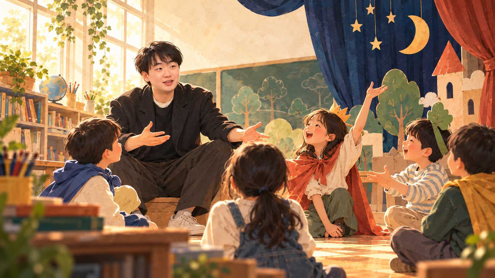

# 배움을 연구하고, 장면으로 열고, 도구로 만든다.

**초등교사 · 교육연극 실천가 · 연구자**

학생이 자기 목소리로 참여하는 수업을 고민하고, 교실의 질문을 연구와 디지털 도구로 이어 갑니다.

---

## 하는 일

- **수업** — 교육연극과 놀이로 학생의 대화·탐구·참여를 설계합니다.
- **연구** — 교사의 경험을 질적 연구로 성찰하고, 주장과 근거의 연결을 점검합니다.
- **제작** — 현장의 아이디어를 다른 사람도 사용하고 고칠 수 있는 도구로 구현합니다.

## 대표 프로젝트

### 📚 [Research Orchestrator Kit (ROK)](https://github.com/yangyeontae-blip/research-orchestrator-kit)

연구 아이디어에서 APA 7·JQI 연구계획서, 문헌 근거 검토, 보완본까지 이어 주는 로컬 우선 연구 도구입니다. PDF·HWP·HWPX를 로컬에서 다루고, 수집과 반영은 연구자의 승인을 거치도록 설계했습니다.

[저장소 보기](https://github.com/yangyeontae-blip/research-orchestrator-kit) · [소개 영상 보기](https://yangyeontae-blip.github.io/research-orchestrator-kit/video/player/)

### 🌳 [베리숲 모험학교](https://yangyeontae-blip.github.io/math/)

초등학교 1–6학년 수학을 숲 탐험으로 만나는 3D 학습 게임입니다. 문제를 풀고 힌트를 살피며 각자의 속도로 다시 도전할 수 있습니다.

[게임 해 보기](https://yangyeontae-blip.github.io/math/) · [저장소 보기](https://github.com/yangyeontae-blip/math)

## 연구와 현장

| 영역 | 기록 |
| :--- | :--- |
| **연구** | **2024** · 「한 초등학교 초임교사의 생존전략에 대한 자문화기술지」, *질적탐구* 10(2), 113–139 |
| **교육연극** | **2024** · 학생중심연극교육연구회 회장 · 교사 15명과 학생 주도 성장 및 교육연극 교수법 연구 |
| **현장 지원** | **2023–2025** · 충주 지역 놀이학년제 컨설턴트 · 놀이 기반 교육과정 컨설팅과 교사 연수 참여 |

---

> 좋은 수업은 더 많은 목소리가 참여할 때 시작된다고 믿습니다.
